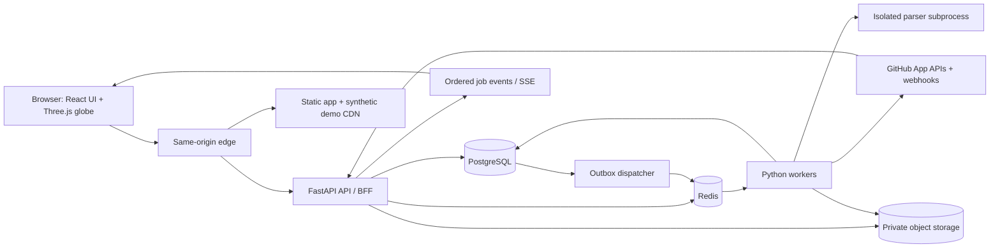

# DevWorld — Architecture

**Specification:** v1.0 · 2026-09-26  
**Decisions:** Web-first; modular Python backend; React/Three.js client; GitHub App; immutable artifacts  
**Related:** [TECH_STACK.md](TECH_STACK.md), [API_SPEC.md](API_SPEC.md), [DATA_MODEL.md](DATA_MODEL.md), [SECURITY.md](SECURITY.md)

## 1. System shape

Ship a modular monolith with separate API and worker processes. These are deployment units of the same backend codebase, not independently owned microservices. One same-origin web application serves static assets and proxies `/api/v1` to FastAPI. Start with PostgreSQL, Redis, and private S3-compatible object storage. Use a CDN for application assets and the bundled synthetic demo; protected world artifacts pass through an authorized asset gateway.

PostgreSQL is authoritative for users, permissions, jobs, versions, and publication. Redis transports work and stores short-lived coordination; losing Redis must not lose the only copy of an accepted job. Repository source is untrusted input at every stage.

## 2. Domain boundaries

| Module | Owns | Does not own |
|---|---|---|
| Identity/integrations | Sessions, GitHub grants, installation eligibility, permission checks | Geometry or repository execution |
| Worlds | Inclusion policy, world seed, immutable versions, active pointer | Raw source rendering |
| Ingestion | API pagination, trees, blobs, commits, provider backoff | UI state |
| Analysis | Parser adapters, symbols, static dependency evidence, metrics | Executing imports, package installation, builds |
| History | First-parent lineages, checkpoints, changes, snapshot resolution | Inventing historic GitHub metadata |
| Layout | Country slots, folder subdivisions, tile generation | Permissions or current UI camera |
| Delivery | Authorized manifests, tiles, entity/search endpoints, SSE | Trusting browser-supplied ownership |
| Lifecycle | Revocation, purge, retention, reconciliation | Deleting the user's GitHub repositories |

Interfaces are typed Python functions and shared schemas. Extract a service only after measurements show an independent scaling or isolation need.

## 3. Browser architecture

`world-shell` owns routes, authentication, panels, search, and keyboard navigation. `scene-engine` owns render resources, picking, camera and effects. `semantic-zoom` maps projected bounds to visibility and detail requests. `tile-streamer` handles fetch priorities, cancellation, worker decode, memory accounting and eviction. `timeline-controller` resolves snapshots and ignores stale requests. `accessible-atlas` mirrors navigation in the DOM.

Use TanStack Query for server state and Zustand for local selection/camera/tool preferences. Do not place per-frame transforms in React state. One render loop updates camera and animation; HTML overlays receive throttled projected positions. Background tabs stop animation. Idle scenes use on-demand frames; flights and timeline morphs request frames explicitly.

Three independent identities prevent state confusion:

- `world_version_id`: captured repository roster, heads, pipeline and layout policy.
- `snapshot_id`: a resolved time view, including one commit/state per country.
- `entity_id`: persistent logical object where identity is confidently known.

Client state also carries a request sequence. A network result updates the scene only if its sequence and snapshot match the current intent. Existing parent geometry stays visible while finer tiles load. Data from two snapshots must not be silently merged.

## 4. Authentication and permission boundary

Choose a GitHub App. Backend user authorization establishes identity and user-visible repository eligibility; the installation grants selected repository access for indexing. GitHub user tokens reflect both the app's and the user's access, while an installation credential alone does not establish the viewing user's rights. [GitHub authentication guidance](https://docs.github.com/en/apps/creating-github-apps/about-creating-github-apps/best-practices-for-creating-a-github-app).

MVP permits worlds for the signed-in user's personal GitHub account only. Organization/team worlds are deferred. Background ingestion uses narrowly scoped installation tokens only for included repositories and a still-valid grant. User-triggered provider lookups use the user credential. Every DevWorld read independently checks session, world ownership, repository inclusion, current grant state, and the artifact's world/snapshot membership.

Never send GitHub credentials to the browser. The browser gets an opaque HttpOnly session cookie. Private data uses `Cache-Control: private, no-store`; no service-worker persistence. Source preview has a separate explicitly enabled endpoint. The authorization policy applies to historical data and derived geometry as well as source.

## 5. Ingestion and publication

1. Confirm personal account identity and selected installation repositories.
2. Save inclusion policy, a `jobs` row, and an `outbox` message in one transaction.
3. Dispatcher sends the job ID to Redis; a worker acquires a database lease.
4. Capture repository IDs, refs and head OIDs once. All subsequent reads use immutable OIDs, not a moving branch name.
5. Publish an immutable `preview` world version containing complete known country metadata, placeholder flags, and no false completion claim.
6. Fetch and normalize trees; analyze permitted text blobs in isolated processes; derive history and layout.
7. Upload artifacts under private, versioned keys. Check counts, size, SHA-256 and parent references.
8. Insert manifests and mark the full version `ready` in a database transaction. Compare-and-swap the active version only if inclusion/grant generation still matches the job's captured generation.
9. Emit `version.available`. The browser can adopt it while preserving entity selection and time; if an entity is gone, select its closest existing ancestor and explain the change.

Preview and ready versions are distinct immutable IDs. Never progressively overwrite one published manifest. Old valid versions stay usable only while current permissions allow access. A newer inclusion policy or deletion cancels stale publication even if parsing finishes successfully.

Job stages are idempotent using `(world_id, repository_id, commit_oid, stage, pipeline_hash)`. Delivery is at least once. Use leases, heartbeats, bounded retry with jitter, dead-letter state in PostgreSQL, and an outbox sweeper to recover lost broker messages. Discard incomplete objects through a later garbage-collection pass.

## 6. History and time resolution

There is no single commit for a GitHub account. World history resolves a revision vector: one selected commit per included repository. MVP traverses the first-parent ancestry of each default-branch head captured in the world version. This shows mainline evolution including merge results. It does not claim every side-branch commit occurred on the mainline. Alternate branches use an explicit lineage later.

Store original Git timestamps and a monotonic `effective_at` for the chosen lineage; DATA.md specifies clock-skew handling. Dates before indexed coverage are `before_coverage`, not an empty tree. An exact commit can be displayed when its full tree is known even if older history is partial. UI precision (`exact`/`preview`) and coverage (`complete`/`partial`) are separate fields.

Checkpoints hold membership maps at selected commits. Reconstruct an uncached intermediate state by applying ordered, first-parent change events from the nearest checkpoint, then verify its tree fingerprint against the selected commit. Periodic checkpoints default to every 100 indexed mainline commits. Current state and important requested states are materialized as repository snapshots; not every commit duplicates every entity row.

Commit/tree OIDs refer to repository contents. Non-Git properties such as stars, issue status, repository membership and visibility use separately dated observations. Present observed history only; DATA.md defines what cannot be reconstructed.

## 7. Layout and globe mathematics

Persist `world_seed` and `layout_epoch`. Use a deterministic spherical distribution of country anchor slots, allocated in stable repository-ID order at creation. Maintain reserve ocean slots. Country borders derive from a versioned spherical partition and clipped procedural coastline. Existing anchors remain fixed within an epoch; new countries use unused slots. Very large changes trigger an explicit “Rebuild geography” operation after MVP rather than rearranging the world silently.

Weight country area by `clamp(log1p(source_bytes), min_weight, max_weight)` with a minimum selectable island. Fit weights within fixed cells; this deliberately favors spatial memory over perfectly proportional area. Historical absence hides a country but leaves its slot vacant. Timeline playback never repacks the planet.

Within a country, allocate deterministic hierarchical parcels in a 2D local chart; top-level directories are states, deeper directories are districts, root files are buildings on the country. Map the chart to the sphere at distant levels. Near the surface, blend to a tangent coordinate frame sharing the same anchors. Test poles, the longitude seam, camera collisions and picking across this transition.

Use reusable instanced building meshes, shared materials, screen-space labels, bounding volumes and frustum culling. Symbol cutaways load only after building selection. Animation reconciles IDs between snapshots; it never invents identity for ambiguous renames.

## 8. LOD streaming contract

LOD codes are `L0` world countries, `L1` country/state surfaces, `L2` district/building instances, and `L3` floor/room inspection. They do not equal raw folder depth. DATA.md defines the JSON manifest and binary instance format.

Priority order: selected entity, its children, visible neighbors, then predicted next level. Limit concurrent tile requests to four desktop/two mobile initially. Request ID and AbortController handle cancellation; aborted decoding also checks the latest sequence. Worker outputs transferable buffers; the renderer owns explicit geometry/material disposal.

The asset gateway authenticates every protected tile request and binds the asset ID to its world, snapshot, pipeline and current grant generation. Object storage is private. Do not issue direct long-lived object URLs for private data. App/demo resources may be CDN cached by content hash. Future public shares use an entirely separate sanitized projection and access gateway.

## 9. Source and parser isolation

For MVP, read GitHub trees/blobs through API calls; do not clone or check out repositories on the web server. Never execute package scripts, hooks, tests, imports, notebooks, macros or build tools from imported content. A parser process receives one bounded text input plus language/path metadata, with no credentials, no network, read-only input, and CPU/memory/time limits.

Adapter result: symbols with ranges and confidence, static dependencies with evidence, aggregate metrics, diagnostics and parser/query version. Failing extraction yields a usable file building with `analysis_status=failed|unsupported|excluded`. Code signatures and docstrings are not placed in LOD geometry or public projections.

## 10. Operations and failures

| Failure | Required response |
|---|---|
| GitHub rate/secondary limit | Honor retry headers, reduce concurrency, keep a dated usable version |
| Truncated tree | Recurse through individual trees or label incomplete; never imply all files were fetched |
| Worker crash | Lease expires; retry same stage and deduplicate writes |
| Redis lost | Re-enqueue accepted jobs from database/outbox |
| Storage upload failure | Do not publish manifest; retry bounded stage |
| Parser crash | Record file diagnostic, preserve building-level navigation |
| Force push | Build a new immutable lineage; no fabricated continuity |
| Revocation/exclusion | Deny reads, cancel jobs, invalidate sessions/caches, enqueue purge |
| WebGL context loss | Recreate resources once; repeated loss selects the DOM atlas |

Track request/job IDs, API latency, queue age, tree coverage, parser failures, tile latency, estimated memory, frame times and time-resolution duration. Metrics/logs exclude source, credentials and private names/paths. Persist authorization and deletion audit actions with opaque IDs. SLOs and restore drills are defined in WORKFLOW.md.

## 11. Desktop extension

Consider Tauri only after the web experience is proven. Reuse the renderer and versioned analysis contracts. A local sidecar analyzes only an explicitly selected repository root and stores results locally; a later adapter can expose the same APIs through authenticated IPC. It must not upload local source or world artifacts automatically.

Use granular Tauri capabilities plus explicit allowed paths; backend code still performs path and symlink checks. [Tauri capabilities](https://v2.tauri.app/security/capabilities/). Keep credentials in the OS vault and grant filesystem scope only to the chosen directory. Bundling Python and parsers across platforms is a real delivery cost; prototype it before committing to the wrapper. Browser-only folder import and Git upload are not MVP features.

## 12. Initial architectural decisions

| ID | Decision and reason | Revisit when |
|---|---|---|
| ADR-001 | GitHub App; selected repositories and read-only permissions | Organization tenancy is requested |
| ADR-002 | React + R3F/Three.js/WebGL2; practical browser support | Measured renderer limits justify WebGPU |
| ADR-003 | FastAPI modular monolith + separate workers | Isolation/scale requires a service boundary |
| ADR-004 | Immutable versions + per-repo temporal vector | Cross-branch comparison is implemented |
| ADR-005 | Protected asset gateway; no direct private CDN URLs | Authenticated edge delivery is proven |
| ADR-006 | Stable country slots within a layout epoch | Real account density defeats packing |
| ADR-007 | No persisted raw source by default | A user-approved source feature needs retention |

Future ADR files belong under `docs/adr/` in the implementation repository. Record context, alternatives, migration and test impact before changing these decisions.
