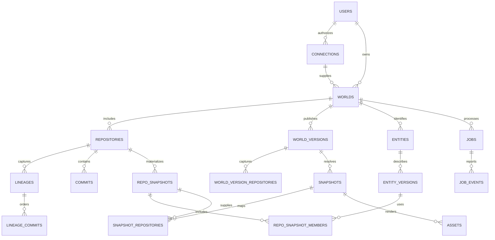

# DevWorld — Data Model

**Specification:** v1.0 · 2026-09-26  
**Persistence:** PostgreSQL relational metadata plus private immutable object artifacts  
**Related:** [DATA.md](DATA.md) defines meaning; [API_SPEC.md](API_SPEC.md) defines transport; [SECURITY.md](SECURITY.md) defines access and retention

## 1. Conventions

Internal IDs are UUIDs generated server-side. Provider numeric IDs are `text` containing validated decimal strings. Git OIDs use `object_format` plus hex `oid`; no fixed 40-character assumption. Times are `timestamptz`, exposed as UTC RFC 3339. All mutable records have `created_at`, `updated_at`, and an integer `row_version` where optimistic concurrency is required. Artifact and entity-version records are immutable after publication.

Every world-scoped table includes `world_id`, even when reachable through another foreign key. Composite foreign keys enforce same-world relationships. Use the application permission layer on every query; database row-level security can add defense in depth, but is not the only control. Workers receive scoped world/job IDs and never unrestricted user-query filters.

Use `bigint` for byte counts/line counts and nonnegative constraints. APIs serialize potentially unsafe integers as strings if they could exceed JavaScript's exact range. JSONB is for versioned metrics/coverage/evidence, not for replacing core foreign keys. Names and paths are data, never SQL identifiers.

## 2. Relationship overview

Repository membership is historical through the captured version roster. The actual account's historical ownership is not inferred. World-version and snapshot authorization always use current grants/policy.

## 3. Identity and access tables

### `users`

`id uuid PK`, `github_user_id text UNIQUE NOT NULL`, `login text`, `display_name text NULL`, `status active|deleting|deleted`, timestamps. Login is mutable and never a primary identity. Avoid collecting email by default.

### `connections`

`id uuid PK`, `owner_user_id FK users`, `github_account_id text`, `github_installation_id text`, `account_type user|organization`, `status active|suspended|revoked|disconnected`, `grant_generation bigint`, `permissions jsonb`, `permission_checked_at timestamptz`, `credential_ref text`, timestamps. MVP requires `account_type=user` and the account ID to equal the owner's GitHub ID. Unique active connection per `(owner_user_id, github_installation_id)`.

`credential_ref` points to encrypted credential storage; it is not a plaintext token. A credential record contains ciphertext, encrypted data key, KMS key reference, token type, expiry and revocation state. Refresh credentials are separated from active-token cache entries. These records never serialize into application APIs.

### `sessions` and `auth_transactions`

Sessions: digest PK, `user_id`, CSRF digest, idle/absolute expiries, revoked time and creation time. Auth transactions: random state digest PK, initiating browser-session binding, encrypted PKCE verifier, approved relative return path, expiry and consumed timestamp. Consume with an atomic condition to prevent callback replay.

### `worlds`

`id uuid PK`, `owner_user_id`, `connection_id`, `github_account_id text`, `root_entity_id uuid`, `display_name text`, `world_seed text`, `layout_epoch integer`, `policy_generation bigint`, `source_preview_enabled boolean DEFAULT false`, `status indexing|ready|deleting|deleted|suspended`, `active_version_id uuid NULL`, timestamps.

Unique active world per `(owner_user_id, github_account_id)`. `world_seed` is stable across username changes. `policy_generation` increases on inclusion/exclusion, serialized-data policy changes and deletion. Display-name and owner source-preview toggles change row version only; preview permission is evaluated live. `active_version_id` must belong to this world and be published. The root entity link is deferred until both rows exist in one transaction.

### `repositories`

`id uuid PK`, `world_id`, `github_repository_id text`, `country_entity_id uuid`, `current_owner_login text`, `current_name text`, `visibility public|private|internal`, `default_ref text NULL`, `archived boolean`, `included boolean`, `provider_created_at timestamptz NULL`, `observed_at`, `permission_checked_at`, `permission_status allowed|denied|unknown`, `layout_slot integer`, timestamps.

Unique `(world_id, github_repository_id)` and `(world_id, layout_slot)`. The country entity has kind `repository`. A rename changes labels, not this repository ID or slot. `internal` repositories are not supported by personal-account MVP and must not be downgraded to public.

### `repository_observations`

`id`, `world_id`, `repository_id`, `observed_at`, `name`, `visibility`, `archived`, `default_ref`, optional overlay metrics. These are observations, not Git-derived historic truth. No contributor email or source content in JSON metrics.

## 4. Immutable capture and Git history tables

### `world_versions`

`id uuid PK`, `world_id`, `status preview|ready`, `published_at`, `captured_at`, `policy_generation`, `grant_generation`, `pipeline_hash`, `schema_version integer`, `layout_epoch`, `coverage complete|partial`, `coverage_reasons text[]`, `manifest_asset_id uuid NULL`.

Only published captures exist here; staging state belongs to jobs. A preview is complete as a metadata-only artifact and immutable. The later detailed version has a new ID. Null `manifest_asset_id` is allowed only during the publication transaction, resolved before commit and enforced by a deferred validation trigger. Version hash/input metadata must be retained for reproducibility.

### `world_version_repositories`

PK `(world_version_id, repository_id)`, plus `world_id`, `captured_ref text NULL`, `captured_head_oid text NULL`, `lineage_id uuid NULL`, `detail_available metadata|structure|symbols`, `history_complete_to_root boolean`, `oldest_indexed_at`, `newest_indexed_at`, `coverage`, `coverage_reasons`. A no-commit repository has a null head and explicit empty status in snapshot resolution.

### `commits` and `commit_parents`

Commits: PK `(repository_id, oid)`, `world_id`, `object_format`, `tree_oid`, `authored_at`, `committed_at`, `observed_at`, optional safe contributor ID, and `metadata_complete boolean`. Commit messages are not required for MVP; if later retained, classify and redact them as source-adjacent sensitive content.

Parents: PK `(repository_id, commit_oid, parent_index)`, `parent_oid`, `world_id`. `parent_index=0` is first parent. Keep parent OID text even if a parent is outside indexed coverage; do not require the referenced commit row until fetched. An OID is immutable, but fetch completeness may advance before capture publication.

### `lineages` and `lineage_commits`

Lineage: `id`, `world_id`, `repository_id`, `ref_name_at_capture`, `head_oid`, `oldest_indexed_oid`, `complete_to_root boolean`, `captured_at`, `lineage_hash`. A new force-pushed ancestry gets a new lineage ID.

Lineage member: PK `(lineage_id, ordinal)`, `world_id`, `repository_id`, `commit_oid`, `effective_at`, `clock_adjusted boolean`. Unique `(lineage_id, commit_oid)`. An ordinal is meaningful only within its lineage. `effective_at` is the prefix maximum of committed timestamps in ancestry order, as specified in DATA.md. Published lineage membership does not change; deeper indexing publishes another lineage/capture.

### `change_events`

`id`, `world_id`, `repository_id`, `commit_oid`, `parent_oid NULL`, `entity_id`, `operation added|removed|modified|renamed|moved`, `before_version_id NULL`, `after_version_id NULL`, `confidence exact|high|uncertain`, `evidence jsonb`, `pipeline_hash`.

Unique `(repository_id, commit_oid, entity_id, pipeline_hash)`. One event can encode changed name/path/content in its before/after versions; choose `moved`, then `renamed`, then `modified` as display precedence. Add requires only after; remove only before; other operations both. Events compare the chosen commit with its first parent. No duplicated replay of merge-side events.

## 5. Entities and immutable versions

### `entities`

`id uuid PK`, `world_id`, `repository_id uuid NULL`, `kind world|repository|directory|file|class|component|function`, `created_at`, `identity_algorithm_version`, optional `origin_entity_id` for a documented copy/refactor relationship.

Only the world root has null repository ID. One root entity/world and one country entity/repository. Logical existence at a historical time comes from snapshot membership, not `created_at`, which records indexing time. Do not use a mutable `deleted` flag to decide historical visibility.

### `entity_versions`

`id uuid PK`, `world_id`, `entity_id`, `parent_entity_id uuid NULL`, `name text`, `path text`, optional `path_bytes_base64 text`, `directory_depth integer NULL`, `blob_oid text NULL`, `language text NULL`, `range_start_line`, `range_start_column`, `range_end_line`, `range_end_column`, `analysis_status ready|unsupported|failed|excluded|pending`, `exclusion_reason text NULL`, `metrics jsonb`, `parser_version text NULL`, `query_version text NULL`, `definition_hash text`.

Unique `(entity_id, definition_hash)`. Parent/name/path/ranges change by version. Store derived structure, not raw function bodies, signatures or docstrings. Directory depth applies only to directories. Symbol ranges use 1-based lines and 0-based UTF-8 byte columns, exclusive end. File path is repository-relative; symbols reuse their file path and have distinct IDs/ranges. Names and paths are protected fields.

Parent validity at a materialized state:

- Repository → world root.
- Directory → repository or directory.
- File → repository or directory.
- Class/component → file or supported enclosing class/component.
- Function → file, class/component or enclosing function.

Validate acyclicity and parent membership before publication. A parent FK alone cannot prevent cycles. Function nesting remains rooms within the owning building/floor; it does not become fake districts.

### `dependency_edges`

`id`, `world_id`, `repo_snapshot_id`, `source_entity_id`, `target_entity_id NULL`, `external_target_label NULL`, `relation imports|contains_reference`, `resolution resolved|external|unresolved`, `evidence_range jsonb NULL`, `analyzer_version`.

Unique normalized edge key per snapshot. Resolved targets must belong to the same authorized snapshot or an explicitly allowed included repository in that world snapshot. MVP can restrict roads to same-repository imports. Do not equate static references with runtime invocation.

## 6. Materialized and world snapshots

### `repo_snapshots`

`id`, `world_id`, `repository_id`, `commit_oid`, `pipeline_hash`, `root_tree_oid`, `membership_fingerprint`, `coverage`, `coverage_reasons`, `created_at`, `checkpoint_asset_id NULL`.

Unique `(repository_id, commit_oid, pipeline_hash)`. Only verified materializations enter this table. Pipeline hash includes parser/query versions and source-exclusion policy. Reuse a repo snapshot only under matching pipeline/policy. A failed materialization is a failed job, not a ready snapshot with missing rows.

### `repo_snapshot_members`

PK `(repo_snapshot_id, entity_id)`, plus `world_id`, `repository_id`, `entity_version_id`. Contains country and descendant entities, excluding world root. Foreign keys enforce snapshot and entity/version are in the same repository/world. Full maps exist only for materialized states; intermediate checkpoints/deltas may remain in object storage until requested.

### `snapshots`

`id`, `world_id`, `world_version_id`, `scope_entity_id`, `selector_type latest|time|commit`, `requested_at timestamptz NULL`, `requested_commit_oid text NULL`, `requested_repository_id uuid NULL`, `precision exact|preview`, `coverage complete|partial`, `coverage_reasons`, `resolution_hash`, `created_at`, `manifest_asset_id`.

Exactly one selector is provided: `latest` with no target fields, `time` with only a timestamp, or `commit` with only a repository+commit pair. Latest chooses captured heads independently of Git dates. Snapshot records are immutable resolved results. Pending work is represented by a job and API `202`, not a partially populated snapshot. `resolution_hash` includes capture/version, selector, scope, revision vector, pipeline and projection context for reuse.

### `snapshot_repositories`

PK `(snapshot_id, repository_id)`, plus `world_id`, `lineage_id NULL`, `resolved_commit_oid NULL`, `repo_snapshot_id NULL`, `status resolved|not_yet_created|before_coverage|empty|unavailable`, `coverage`, `coverage_reasons`, `oldest_indexed_at NULL`, `newest_indexed_at NULL`.

`resolved` requires commit and repo-snapshot references; non-resolved states require null repo-snapshot. `not_yet_created` requires complete-to-root evidence. World scope includes the whole captured eligible roster; a repository/folder/file/symbol scope includes its containing repository only. Revoked repositories are filtered/denied by current policy rather than exposed as named unavailable entries to an unauthorized user.

## 7. Artifacts, layout and processing

### `layout_records`

`world_id`, `layout_epoch`, `entity_id`, `anchor jsonb`, `bounds jsonb`, `slot integer NULL`, `layout_version`. Unique `(world_id, layout_epoch, entity_id)`. Country slots persist through time; historical absence does not repack neighbors. Children may have layout variants keyed by their materialized parent definition if required, while stable sibling anchors are preserved.

### `assets`

`id uuid PK`, `world_id`, `world_version_id NULL`, `snapshot_id NULL`, `projection_id NULL`, `asset_kind world_manifest|snapshot_manifest|tile_header|instances|mesh|checkpoint`, `lod L0|L1|L2|L3 NULL`, `entity_id NULL`, `object_key text`, `content_sha256 text`, `byte_length bigint`, `uncompressed_byte_length bigint`, `schema_version`, `pipeline_hash`, `policy_generation`, `grant_generation`, `created_at`.

Exactly one owning context—world version, snapshot or projection—must be set. Private object keys do not contain paths or names. Content hashes are integrity checks, not access tokens. `asset_id` never bypasses world/snapshot authorization. Object uploads become readable only after their database context is published.

### `jobs`, `job_events`, `outbox`

Jobs: `id`, `world_id NULL`, `owner_user_id`, `kind ingest|resolve_snapshot|purge|reconcile|build_share`, `status queued|running|retrying|succeeded|failed|cancelled`, `stage`, `idempotency_key`, `input_hash`, `policy_generation`, `grant_generation`, `attempt_count`, `lease_owner NULL`, `lease_expires_at NULL`, `heartbeat_at NULL`, `next_attempt_at NULL`, `progress_completed`, `progress_total NULL`, `result_type NULL`, `result_id NULL`, `error_code NULL`, timestamps.

Unique `(owner_user_id, kind, idempotency_key)` while an idempotency record is retained. Result points to a world version, snapshot or projection according to job kind. Progress totals may be unknown. Never store credentials or raw source in job payloads.

Job events: PK `(job_id, sequence)`, `event_type`, `safe_payload jsonb`, `created_at`. Sequence increases transactionally and supports SSE resume. Outbox: ID, aggregate/job ID, event kind, payload containing IDs, delivery attempts and sent timestamp. Create outbox and job changes in the same database transaction.

### `webhook_deliveries`, `audit_events`, `deletion_tombstones`

Webhook delivery: unique provider delivery ID, receipt time, event, installation ID, body digest, processing state. Optional encrypted raw body follows the short SECURITY.md retention.

Audit: ID, pseudonymous actor ID, action, world/resource ID, outcome, safe reason code and time. No source, names, source URLs or secrets.

Deletion tombstone: resource type/opaque ID, accepted time, policy generation, active purge completed time, backup expiry deadline and minimal receipt digest. Tombstones survive backup restore so deleted records cannot become readable again. A receipt credential can query only deletion status, never account data.

## 8. Post-MVP sharing tables

`share_links`: ID, world ID, owner ID, token digest, expiry, revoked time, policy version and projection ID. `share_projections`: ID, approved public repository subset, field allowlist, alias map, built-at/version, source-visibility-check time and status. `share_sessions`: session digest, link ID, expiry and revoked time.

Projection IDs/entity IDs form a separate namespace and only reference sanitized artifacts. Private repositories are excluded regardless of field aliases. No source content or credentials. These tables/routes stay disabled until the sharing security suite passes.

## 9. Constraints, transactions and indexes

Mandatory constraints include cross-world composite FKs, enum checks, nonnegative metrics, immutable published artifact rows, unique provider mappings, unique snapshot membership, acyclic complete hierarchy, checkpoint/event order and current-generation publication.

Add indexes for:

- `worlds(owner_user_id, status)` and `repositories(world_id, included)`.
- `entity_versions(world_id, entity_id)` and a scoped trigram index on search-safe name/path.
- `repo_snapshot_members(repo_snapshot_id, entity_id)` plus reverse entity-version lookup.
- `lineage_commits(lineage_id, effective_at DESC, ordinal DESC)` for time resolution.
- `change_events(repository_id, commit_oid)` and `(world_id, entity_id)` for entity history.
- `snapshot_repositories(snapshot_id, repository_id)` and `assets(snapshot_id, lod)`.
- `jobs(status, next_attempt_at)` for dispatch and `(world_id, created_at DESC)` for status.
- `job_events(job_id, sequence)` and unique `webhook_deliveries(provider_delivery_id)`.

Publication transaction verifies the job lease, world/connection status, policy/grant generations and all artifact references, then inserts the version and updates the active pointer with compare-and-swap. Deletion first changes status/generation and writes the tombstone/outbox atomically; physical purging follows. Retry transactions may not publish a stale version.

## 10. Migration and evolution

Migration order: identities/connections → worlds/repositories → logical entities/versions → Git history → materializations → world versions/snapshots → assets → jobs/events/lifecycle → optional shares. Resolve world-root and active-version cycles through deferred constraints or a final constraint migration.

Use expand/backfill/validate/contract migrations. A schema change affecting tiles increments `schema_version`; changed parsing/layout increments pipeline/layout versions. Old clients get a clear unsupported-schema error and reload prompt. Do not overwrite published rows during migrations; materialize new artifacts and switch pointers. Reconcile DB references with object storage and garbage-collect only unreferenced objects outside the retention grace period.

The acceptance fixture must prove: two files differing only by case remain distinct; a renamed file keeps its ID when exact; copies get new IDs; a missing historical parent fails publication; cross-world asset references fail; a deletion blocks an already-running publisher; and equal/clock-skewed commit dates resolve deterministically.
